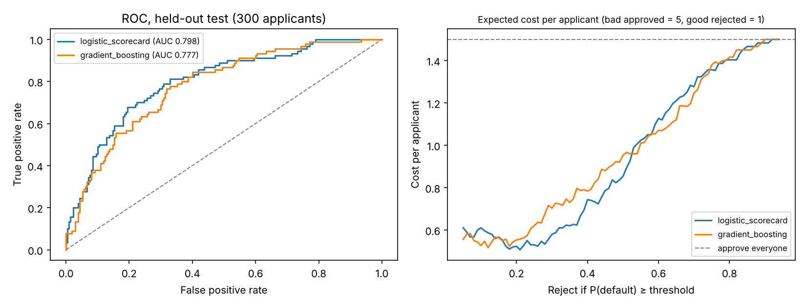

# Credit Default Scorecard: German Credit

[](https://github.com/Drakeion2532/credit-default-scorecard/actions/workflows/tests.yml)

Predicts which loan applicants will default, then sets the approval cut-off by **business cost** instead of the default 0.5 threshold, and turns the model into a **points-based scorecard** of the kind lenders use.



## Data
- German Credit dataset: **1,000 loan applicants, 30% defaulted** (bad = 300, good = 700).
- 70/30 stratified split: 700 for training (5-fold cross-validation), 300 held out for the final test.
- **Removed on fair-lending grounds:** sex/marital status and foreign-worker status. Age is kept; see Limits.

## Approach
1. **Two models:** a regularised logistic regression (one-hot features, the standard scorecard model) and gradient boosting.
2. **Discrimination:** ROC-AUC, Gini (= 2·AUC − 1), KS statistic and PR-AUC, the measures credit-risk teams report.
3. **Cost-based cut-off:** approving a borrower who defaults costs **5×** rejecting one who would have repaid (the cost matrix published with the dataset). The cut-off is chosen on the training folds only, then applied once to the test set.
4. **Scorecard:** logistic coefficients scaled to points: 600 points at 50:1 good:bad odds, 20 points to double the odds.

## Results (held-out test, 300 applicants)

| Model | ROC-AUC | Gini | KS | PR-AUC |
|---|---|---|---|---|
| **Logistic scorecard** | **0.798** | **0.596** | **0.483** | **0.631** |
| Gradient boosting | 0.777 | 0.554 | 0.449 | 0.591 |

The simpler, explainable model won, so it is the one to deploy.

**Logistic scorecard: effect of the cut-off**

| Policy | Approved | Defaults caught | Bad rate in approved | Missed defaults | Good applicants rejected | Cost / applicant |
|---|---|---|---|---|---|---|
| Approve everyone | 100% | 0% | 30.0% | 90 | 0 | 1.50 |
| Threshold 0.5 | 78.7% | 47.8% | 19.9% | 47 | 21 | 0.85 |
| **Cost-based (0.14)** | **30.0%** | **91.1%** | **8.9%** | **8** | **128** | **0.56** |

The cost-based cut-off lowers expected cost per applicant by **34% vs the 0.5 threshold** and **63% vs approving everyone**, and cuts the bad rate among approved loans from 30% to 8.9%.

**The trade-off to discuss in an interview:** under a 5:1 cost ratio the best policy approves only 30% of applicants. That is the price of the cost assumption, not a property of the model. A real lender would also count the profit from each good loan, so the cut-off would sit higher and approve more people. The right-hand chart shows how flat the cost curve is between about 0.1 and 0.25, which gives room to raise approvals with little extra cost.

**Strongest scorecard attributes** (points vs the reference level): no checking account (+40), no/unknown savings account (+28), critical account/other credits existing (+26), savings ≥ 1,000 DM (+22), 4–7 years in employment (+23), renting (−20), loan for retraining (−25). Full list in `results/results.json`.

## Limits (say these before you're asked)
- **Small, old dataset:** 1,000 applicants from 1970s Germany. Results show the method, not current credit performance.
- **Odd-looking signs:** "no checking account" and "critical account" score as *safer*. This is a known quirk of the dataset's coding and sample (it over-represents bad loans), so do not read these as causal.
- **Wide uncertainty:** a 300-row test set means AUC could move by several points on another split.
- **Age is still a feature.** Many fair-lending rules restrict its use; a production model would need a fairness review.
- **No reject inference, no probability calibration check, no time-based validation**, all of which a real scorecard build would include.

## Run it
```bash
pip install -r requirements.txt
python credit_model.py data/german.data
pytest -q          # unit tests + a check that the published numbers reproduce exactly
```
Outputs `results/results.json` and `results/roc_and_cost.png`.
